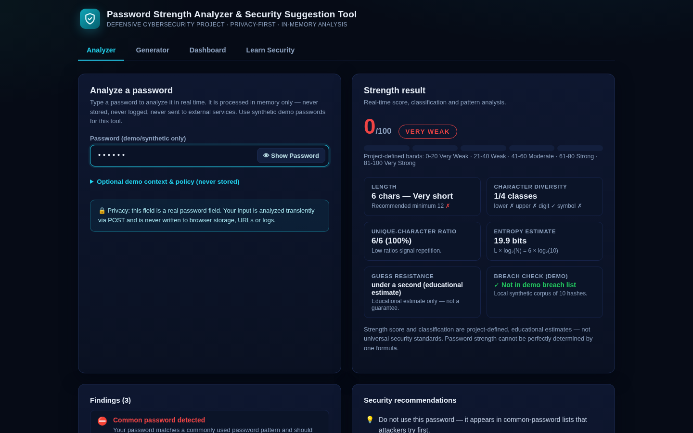
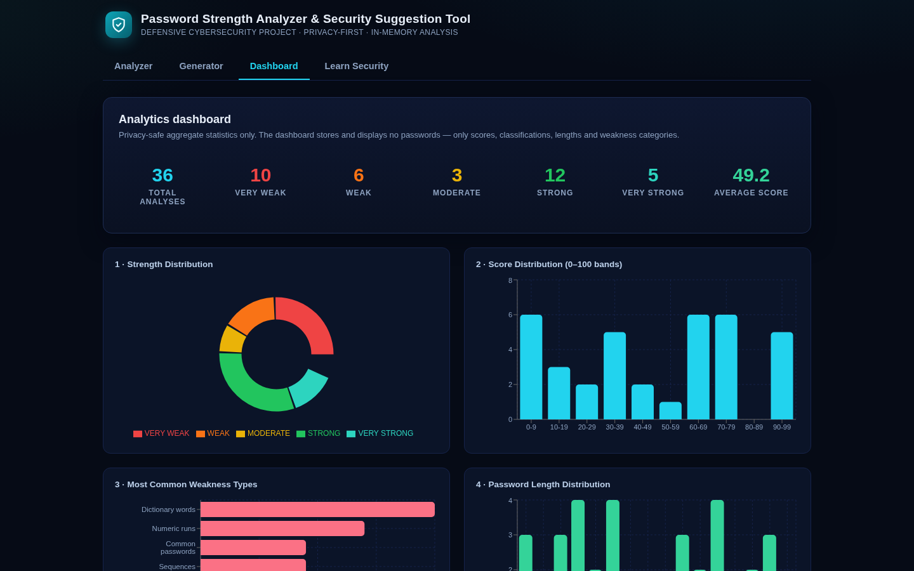

# Password Strength Analyzer & Security Suggestion Tool

> A **privacy-first, defensive cybersecurity project** that evaluates password
> strength in real time, detects common weaknesses (dictionary words, patterns,
> sequences, keyboard walks, repetition, predictable structures, personal-info
> overlap, demo breach exposure), and returns **specific, actionable security
> suggestions** — without ever storing, logging, or transmitting the password.



---

## Overview

Weak and reused passwords remain one of the top causes of account breaches.
This tool behaves like the strength meters, breach checks and just-in-time
coaching used by security portals, IAM teams and consumer apps — while being
**fully local**: analysis happens in memory on your own machine, and the only
thing ever persisted is privacy-safe aggregate metadata.

## Problem Statement

Users systematically overestimate password strength. Composition checkers
("must contain upper/lower/digit/symbol") accept highly predictable passwords
such as `Password123!`, which satisfies every composition rule yet is cracked
instantly. There is a need for an educational tool that:

- measures length, diversity, **predictability**, **pattern resistance**,
  common-password matches and context overlap — not just composition;
- explains *why* a password is weak with specific findings;
- coaches the user toward safer choices with specific suggestions;
- demonstrates **privacy-respecting** analysis (no storage, no leaks).

## Objectives

1. Real-time password strength scoring (0–100) and classification
   (VERY WEAK → VERY STRONG).
2. Multi-signal analysis: length, character diversity, unique-character ratio,
   sequences, keyboard patterns, repetition, dictionary/common passwords,
   predictable word+number/year structures, leetspeak variants, personal-info
   overlap, entropy-style estimate, demo breach exposure.
3. A transparent, explainable **project-defined** scoring model.
4. Specific security suggestions plus passphrase education.
5. A cryptographically secure demo **password generator** (`secrets`).
6. A configurable **password policy checker** (POLICY PASS/FAIL, separate
   from the strength score).
7. Privacy-safe **aggregate analytics dashboard**.
8. Automated functional + security/privacy testing with real evidence.

## Cybersecurity Relevance

- **Authentication systems, banking, e-commerce, enterprise portals, cloud
  apps and IAM systems** all deploy strength meters and breached-password
  rejection to reduce account takeovers and support compliance
  (NIST SP 800-63B, OWASP ASVS).
- Skills demonstrated map directly to roles: *Cybersecurity Analyst,
  Application Security Analyst, IAM Analyst, Security Engineer, SOC Analyst,
  Secure Software Developer*.

## Features

| # | Feature | Where |
|---|---------|-------|
| 1 | Real-time strength meter (segmented, no page refresh) | Analyzer tab |
| 2 | Show/hide password (default hidden, real `type="password"` field) | Analyzer |
| 3 | Length / diversity / unique-ratio metrics | Analyzer |
| 4 | Sequence, keyboard, repetition, date, numeric-run detection | Analyzer |
| 5 | Common-password + dictionary + leetspeak detection | Analyzer |
| 6 | Optional personal-context overlap check (never stored) | Analyzer |
| 7 | Entropy estimate (+honest limitation) & guess-resistance label | Analyzer/Learn |
| 8 | Transparent score breakdown with penalties | Analyzer |
| 9 | Specific security recommendations | Analyzer |
| 10 | Policy checker (configurable min length, POLICY PASS/FAIL) | Analyzer |
| 11 | Local **synthetic demo** breach check (k-anonymity concept) | Analyzer |
| 12 | Secure password/passphrase generator (`secrets`) | Generator tab |
| 13 | Aggregate dashboard + 5 charts (no passwords!) | Dashboard tab |
| 14 | Passphrase + MFA + hashing education, 10 security rules | Learn tab |
| 15 | REST API with validation, redacted errors, rate limiting | API |
| 16 | 60+ automated tests incl. privacy/security verification | `tests/` |
| 17 | Standalone educational password-hashing demo (PBKDF2) | `scripts/hashing_demo.py` |

## Architecture

```
                    User
                     │
        Secure Web Interface (React + Vite)
                     │  POST /api/analyze (body only, never URL)
                     ▼
              Password Input
                     │
              In-Memory Analysis
        ┌──────────────────────────────┐
        │  Length Analyzer             │
        │  Character Analyzer          │
        │  Common Password Checker     │
        │  Dictionary / Leetspeak      │
        │  Sequence Detector           │
        │  Keyboard Pattern Detector   │
        │  Repetition Detector         │
        │  Predictable Structure       │
        │  Context Checker (optional)  │
        │  Entropy Estimator           │
        └──────────────────────────────┘
                     ▼
         Strength Scoring Engine  ──►  Classification
                     │                    (VERY WEAK…VERY STRONG)
                     ▼
         Suggestion Engine + Policy Checker
                     ▼
                    User
   (optional) Safe Aggregate Metrics ONLY
                     ▼
          Analytics Database (SQLite)
                     ▼
                 Dashboard
```

**The password itself never travels into analytics storage.**

## Technology Stack

| Layer    | Choice                          | Why |
|----------|---------------------------------|-----|
| Frontend | React 18 + Vite 5               | Real-time UI, component model (PDF "modern" option) |
| Backend  | Python 3.10+ · FastAPI · Uvicorn | Typed, fast, auto-validation (PDF "modern" option) |
| Charts   | Recharts                        | React-native dashboard charts |
| Database | SQLite (stdlib)                 | Zero-config local analytics |
| Tests    | pytest + FastAPI TestClient     | Unit + API + privacy verification |

## Password Analysis

`backend/services/password_analyzer.py::analyze_password()` orchestrates:

- **Length analysis** — bands: `<8` very short · `8–11` short · `12–15` better ·
  `16+` strong contribution. *Length alone never suffices:*
  `aaaaaaaaaaaaaaaaaaaa` is long but predictable.
- **Character analysis** — lower/upper/digit/symbol/space counts,
  `character_type_count`, `unique_character_count`, `unique_character_ratio`.
  Diversity helps but is never sufficient: `Password123!` has 4/4 classes.
- **Common-password detection** — local educational list
  (`data/common_passwords.txt`). A match shows: *"Your password matches a
  commonly used password pattern and should not be used."*
- **Dictionary detection** — local word list incl. substring scan
  (`monkeybusiness`) and **leetspeak normalization** (`P@ssw0rd → password`).
- **Sequence detection** — ascending/descending runs of letters/digits
  (`1234`, `dcba`, `abcd` ≥ length 3).
- **Keyboard detection** — QWERTY row runs (`qwerty`, `asdf`) + walks
  (`1qaz2wsx`), precision-tuned against English false positives.
- **Repetition detection** — repeated characters (`aaaa`) and repeated
  substrings (`abcabcabc`).
- **Predictable structure** — `word + digits/symbols` and `word + year`
  (`welcome123`, `admin2026`).
- **Personal-context overlap** (optional, never stored) — first name, birth
  year, organization (`Rahul@123` → *"Password appears to contain personal
  information."*).
- **Entropy-style estimation** — `Entropy ≈ L × log₂(N)` *with the explicit
  limitation that it assumes random selection*: `Password123!` gets an
  optimistic ~79 bits yet remains predictable, so entropy is combined with
  pattern analysis, never used alone. Guess-resistance numbers are labelled
  **"educational estimate only"**.
- **Demo breach check** — local SHA-1 comparison against a tiny **synthetic**
  corpus. No external service; production equivalent explained (k-anonymity).

## Pattern Detection

6 detector modules under `backend/services/` return structured findings
`{type, severity, title, description, detail}`. The *generic* description is
safe to persist; details are transient and returned only to the requester.

## Strength Scoring

0–100 score = contributions − penalties (both fully transparent in the UI):

| Contribution | Max | Penalty | Value |
|---|---|---|---|
| Length | +35 | Common password | −40 & hard cap ≤ 15 |
| Character diversity | +15 | Repeated characters | −25 |
| Unique-char ratio | +10 | Personal info | −15 (cap −30) |
| Pattern resistance | +20 | Dictionary word | −12 |
| Non-common password | +10 | Predictable structure | −8 |
| Unpredictability | +10 | Sequence / keyboard | −8 each |
| | | Year·date / numeric run | −6 / −4 |
| | | Leetspeak variant | −6 |

Classification bands (**project-defined, not universal standards**):
`0–20 VERY WEAK · 21–40 WEAK · 41–60 MODERATE · 61–80 STRONG · 81–100 VERY STRONG`.

Hard teaching caps: exact common password ≤ 15 · demo breach hit ≤ 10 ·
length < 4 ≤ 15 · length < 8 ≤ 25 · single character class capped by length.

## Security Suggestions

Specific, actionable, never containing the password. e.g.:
*"Your password contains a predictable sequence of characters — remove runs
like ascending or descending letters/numbers."* / *"Avoid reusing passwords
across different accounts."* / *"Use a password manager…"* / *"Enable MFA…"*

## Password Generator

- Python `secrets` (CSPRNG) — **never** `random`.
- Lengths 16/20/24, per-class toggles; each enabled class guaranteed present.
- Passphrase mode (3–8 random words): strength from word *count*, not obscurity.
- Nothing generated is stored; demo output must not be reused verbatim.

## Password Policy Checker

Configurable policy (default: min length 12 · max 128 · common/PII rejected ·
spaces allowed) evaluated independently of the score. **POLICY PASS/FAIL ≠
STRENGTH**: `aaaaaaaaaaaaaaaa` passes the length policy yet classifies WEAK;
the UI demonstrates both concepts side by side.

## Privacy Design

| Rule | Implementation |
|---|---|
| No plaintext storage | In-memory only; DB has **no password column** (proof: `screenshots/25_database_schema_no_password.png`) |
| No hashes of submissions | Unnecessary for this tool → avoided entirely |
| No logging of passwords | Access log = method/path/status only; pytest `caplog` verification |
| Not in URLs | POST body only; query-param passwords rejected (422) |
| Not in API responses | Verified by automated tests |
| Not in error messages | Validation-error handler strips pydantic `input` values ("[redacted]") |
| No browser persistence | No `localStorage`/`sessionStorage` writes anywhere |
| Real password field | `<input type="password">`, hidden by default, show/hide toggle |
| Analytics = metadata only | id, score, class, length, unique ratio, weakness count, timestamp |
| Rate limiting | In-memory sliding window (+ docs note on HTTPS in production) |

Full details: [`docs/PRIVACY.md`](docs/PRIVACY.md).

## Installation

### Windows (one-click)

```bat
git clone <your-repo-url>
cd Password-Strength-Analyzer
scripts\setup_windows.bat
```

### Linux / macOS

```bash
git clone <your-repo-url>
cd Password-Strength-Analyzer
chmod +x scripts/*.sh
scripts/setup_linux.sh
```

Manual alternative: `py -3 -m venv .venv` → activate →
`pip install -r requirements.txt` → `cd frontend && npm install && npm run build`.

## Usage

```bat
scripts\start_backend.bat        :: http://localhost:8000  (API + built UI)
scripts\start_frontend.bat       :: optional Vite dev server :5173
scripts\run_tests.bat            :: full automated test suite
scripts\generate_evidence.bat    :: demo data + hashing demo + tree snapshot
```

1. Open http://localhost:8000
2. Type a **synthetic demo** password (e.g. `Password123!`,
   `qwerty2026!`, `aaaaaaaaaaaaaaaa`) — watch the meter, findings,
   suggestions, policy verdict and breakdown update live.
3. Generate a secure demo password/passphrase in the Generator tab.
4. View aggregate stats + charts in the Dashboard tab
   (seed demo data first: `python scripts/seed_demo_data.py`).
5. Try the educational hashing demo: `python scripts/hashing_demo.py`.

## API Documentation

Base URL: `http://localhost:8000` · Interactive docs: `/docs`

| Method | Path | Purpose |
|---|---|---|
| GET | `/api/health` | Liveness |
| POST | `/api/analyze` | Full analysis; body `{password, context?, policy?}` |
| POST | `/api/generate-password` | Secure generator `{mode,length,…,words,separator}` |
| GET | `/api/dashboard/stats` | Aggregate stats (metadata only) |
| GET | `/api/analytics/weaknesses` | Weakness + pattern frequency |

Example:

```bash
curl -X POST http://localhost:8000/api/analyze \
  -H "Content-Type: application/json" \
  -d '{"password":"ApiDemo-Synthetic-7788!"}'
```

→ `{"score":71,"classification":"STRONG","findings":[…],"suggestions":[…],
"metrics":{…},"policy":{…},"breach_check":{…}}` — **the password is not
returned**. Status codes: `200` ok · `422` validation (details redacted) ·
`429` rate-limited. Full reference: [`docs/API.md`](docs/API.md).

## Testing

**69 automated tests** (`pytest tests/ -v`):

- `tests/test_password_analyzer.py` — 49 tests: the 30 PDF scenarios
  (empty, one-char, short numeric, common, long-repeated, lower/upper/digits/
  symbols only, mixed, sequences, reverse sequence, letter sequences, keyboard,
  repetition, substrings, word+number, word+year, name overlap, birth-year
  overlap, passphrases, Unicode, spaces, max length, score boundaries,
  suggestions, generator, *not stored*, *not logged*, analytics…) + demo
  cases + policy + breach + leetspeak.
- `tests/test_api.py` — 9 tests: endpoints, structure, validation, 422/429,
  generator endpoints, analytics.
- `tests/test_security_privacy.py` — 11 tests: privacy verification below.

## Security Testing

Verified automatically (see `tests/test_security_privacy.py`):

- [x] password is **not stored** (DB dump scan)
- [x] password does **not appear in logs**
- [x] password does **not appear in the database** (nor its hashes)
- [x] password is **not returned** in the API response
- [x] password does **not appear in URL** parameters (rejected)
- [x] password input **uses password field** (masked by default)
- [x] frontend **avoids unnecessary persistence**
- [x] `localStorage` contains **no password**
- [x] `sessionStorage` contains **no password**
- [x] analytics contain **only metadata**
- [x] validation errors are **redacted**

## Results

| Demo input | Score | Class | Key findings |
|---|---|---|---|
| `123456` | 0 | VERY WEAK | common, sequence, numeric run |
| `Password123!` | 38 | WEAK | dictionary word + predictable structure + sequence |
| `aaaaaaaaaaaaaaaa` | 35 | WEAK | repeated chars/substring despite length |
| `qwerty2026!` | 35 | WEAK | keyboard pattern + year |
| `P@ssw0rd` | 15 | VERY WEAK | leetspeak → common password |
| `P@ssw0rd99` | 44 | MODERATE | leetspeak + dictionary + structure |
| `velvet-galaxy-harbor-orchid` | 68 | STRONG | passphrase-style (demo) |
| generated 20-char | 99–100 | VERY STRONG | — |

Dashboard screenshot: (synthetic demo data only)



## Limitations

- Heuristic scoring is educational, not a guarantee: no formula can perfectly
  capture human password predictability.
- Dictionary/common lists are intentionally small and local.
- The breach check is a synthetic demo (production → k-anonymity API).
- Guess-resistance labels assume a specific attacker model.
- English-centric pattern lists; basic leetspeak map.
- Rate limiting is demo-grade in-memory.

## Future Improvements

- Integrate a mature strength-estimation library (e.g. zxcvbn-style) as a
  comparison signal.
- Configurable enterprise password policies + org-level aggregate reporting
  (still never collecting passwords).
- True privacy-preserving k-anonymity breach-corpus checks.
- Password-manager & SSO integration concepts, WebAuthn/passkey education.
- Localization and accessibility improvements.

## Screenshots

See [`screenshots/`](screenshots/README.md) — 26 of the 28-item checklist are
auto-generated by real captures; GitHub items (26–27) are marked
**MANUAL CAPTURE REQUIRED** (never fabricated).

## Learning Outcomes

Multi-signal password analysis, entropy concepts and their limits, pattern
detection, secure randomness (`secrets`), password-hashing concepts
(salt/key-stretching/PBKDF2/Argon2id), privacy-by-design (data minimization,
redacted errors, metadata-only analytics), FastAPI/React engineering,
automated functional + security testing, and honest evidence practices.

## Security Disclaimer

This is a **defensive, educational** project. It contains **no** password
cracking, credential theft, account guessing, or offensive functionality.
Only synthetic demo passwords were used in development, tests and screenshots.
Never submit real passwords to demonstration tools. Scoring bands are
project-defined; strong passwords must be combined with MFA, rate limiting,
secure hashing, session security and user awareness.

## Author

Cybersecurity student project — *Password Strength Analyzer & Security
Suggestion Tool*. Repository: **Password-Strength-Analyzer-Security-Tool**
(GitHub topics: `cybersecurity` `password-security` `password-strength`
`application-security` `python` `fastapi` `secure-coding` `iam`
`security-awareness` `defensive-security`).
